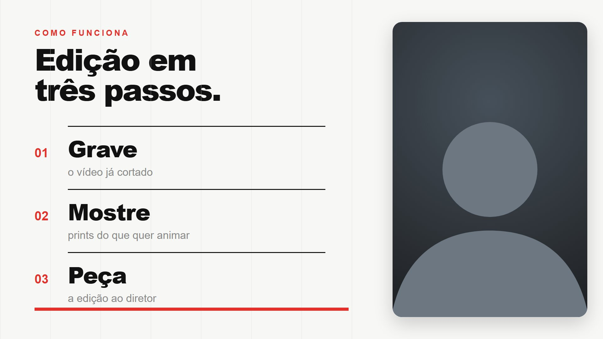
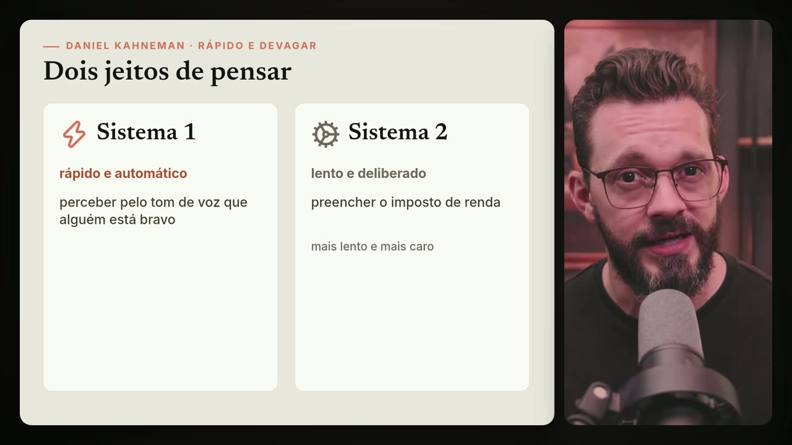
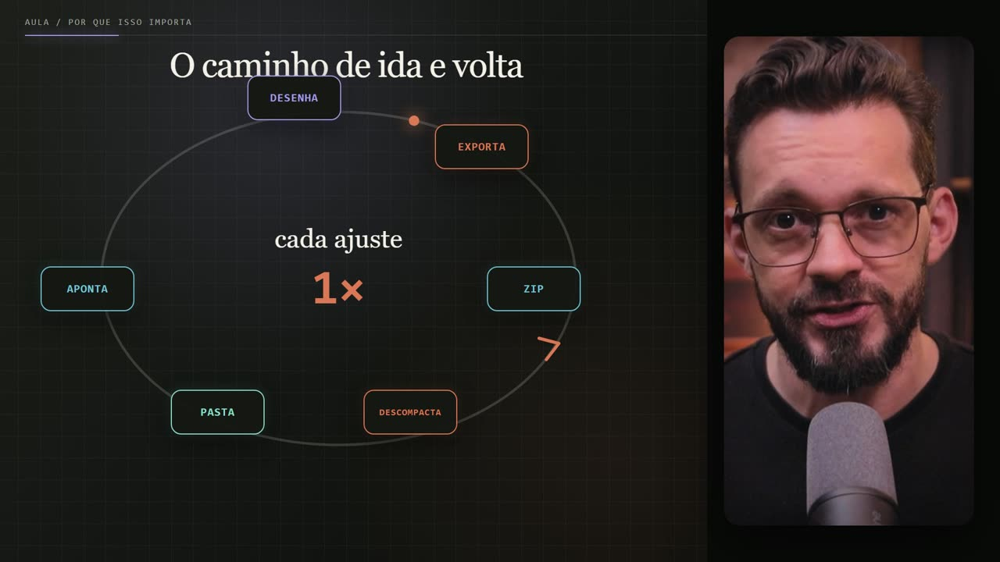

# Studio

**Edite e crie vídeos conversando com um agente de IA.** Uma ferramenta agêntica para trabalho profissional: vídeos longos para o YouTube, Reels/Shorts/TikTok com cortes dinâmicos, ou vídeos criados do zero — textos animados, prints com zoom e marca-texto, tela dividida, gráficos, legendas palavra a palavra, motion graphics e B-roll.

| | | |
|---|---|---|
|  |  |  |

O arquivo [AGENTS.md](AGENTS.md) transforma qualquer agente de IA compatível — **Devin CLI** (recomendado), Claude Code, Codex, Cursor — num **diretor de vídeo**: ao abrir o projeto, ele pergunta o que você quer fazer, confere o que falta instalar, sugere estilos e conduz cada etapa, parando para você aprovar.

## Três modos de trabalho

| | **Edição por cima** | **Edição com cortes** | **Criação do zero** |
|---|---|---|---|
| Ponto de partida | seu vídeo (bruto ou cortado) | seu vídeo bruto | nenhum vídeo — só a ideia |
| O que faz | textos, prints animados, marca-texto, tela dividida, gráficos, legendas, transições | jump cuts, remoção de silêncios e vícios, reordenação, clipes e shorts extraídos | promo, explainer, motion graphics, vídeo de música, legendas, decks animados |
| Motor | [Remotion](https://www.remotion.dev) | ffmpeg + Remotion/HyperFrames | [HyperFrames](https://github.com/heygen-com/hyperframes) ou Remotion |
| Guia | [guias/2-edicao-com-remotion.md](guias/2-edicao-com-remotion.md) | skills `rough-cut`, `shorts`, `podcast-edit` | a skill `hyperframes` se auto-roteia |

Em todos os modos o fluxo é o mesmo:

```text
você entrega o material (vídeo, prints, ideia) em projetos/
   → o agente assiste e transcreve (com o tempo de cada palavra)
   → propõe um plano de edição → você aprova
   → ele produz, mostra quadros de revisão → você aprova
   → o resultado sai em edicoes/
```

O seu material original **nunca é alterado**: os cortes e montagens saem como arquivos novos.

## Instalar

O jeito mais fácil: abra o **Devin CLI** (`devin`) ou outro agente e cole:

```text
Instala o repositório https://github.com/leandroleitetech/studio na pasta ~/dev (siga a seção "Instalação" do README).
```

O agente clona o repositório e instala tudo, incluindo as skills gratuitas **remotion-best-practices** e o pacote **hyperframes** (a skill **assistir**, que ensina o agente a "ver" o vídeo com ffmpeg, já vem dentro do repositório em `.devin/skills/`). No fim, abra uma sessão nova dentro da pasta `studio`.

Pré-requisitos no computador: Node.js (22 ou 24 LTS recomendado), Python 3.10+ e FFmpeg. Se faltar algum, o passo a passo para Windows e Mac está em **[guias/1-primeiros-passos.md](guias/1-primeiros-passos.md)**.

### Instalação (instruções para o agente)

Se você é um agente de IA instalando este repositório, faça exatamente isto:

1. Clone: `git clone https://github.com/leandroleitetech/studio.git` na pasta indicada (padrão: `C:\dev` no Windows, `~/dev` no Mac/Linux; evite pastas do OneDrive/iCloud).
2. Entre na pasta e rode **`npm run instalar`**. Ele instala, nesta ordem:
   - dependências do Remotion (`npm install`) e o navegador que ele usa para renderizar;
   - `.venv` do projeto com transcrição local e imagens (`pip install -r requirements.txt`: faster-whisper, Pillow);
   - skills **remotion-best-practices** e **hyperframes** para Devin, Claude Code, Codex e Cursor, só dentro do projeto (`npx skills add ... -a devin claude-code codex cursor`; ficam em `.agents/skills` com links em `.devin/skills` e `.claude/skills`);
   - dependências e navegadores headless das skills do estúdio (playwright, shiki);
   - no fim, `npm run verificar` confere tudo e diz o que falta.
   - a skill **assistir** não precisa de instalação: já está em `.devin/skills/assistir/` e funciona com ffmpeg + leitura de imagens, em qualquer agente.
3. Se `node`, `python` ou `ffmpeg` faltarem, instale-os com o gerenciador do sistema (`winget` no Windows, `brew` no Mac; comandos em [guias/1-primeiros-passos.md](guias/1-primeiros-passos.md)) e rode `npm run instalar` de novo.
4. Termine dizendo à pessoa para **abrir uma sessão nova do agente dentro da pasta `studio`**. Skills instaladas só aparecem numa sessão nova, e é lá que o diretor de vídeo ([AGENTS.md](AGENTS.md)) assume.

Já clonou manualmente? Basta rodar `npm run instalar` dentro da pasta.

## Começo rápido

Depois de instalar:

1. Coloque seu vídeo em `projetos/001. meu-video/video/` e os prints em `projetos/001. meu-video/prints/`. Para criar do zero, pule esta etapa.
2. Abra a pasta `studio` no seu agente (Devin CLI: `devin` dentro da pasta).
3. Diga o que quer: "edita o projeto 001", "extrai os 3 melhores momentos em vertical" ou "cria um promo de 30 s do meu produto". O diretor cuida do resto.

> **Dica que mais faz diferença:** tire print de tudo o que você cita no vídeo (sites, notícias, telas, gráficos) e salve em `prints/`. Animação feita sobre print real fica muito melhor que recriação.

## Estrutura

```text
studio/
├─ AGENTS.md      o diretor de vídeo
├─ .devin/        config do Devin: permissões e skills do projeto
├─ guias/         os manuais, do zero ao avançado
├─ estilos/       galeria de estilos de referência (horizontais e verticais)
├─ projetos/      ← você coloca o vídeo e os prints aqui
├─ edicoes/       ← o vídeo pronto sai aqui
├─ src/           código do Remotion (exemplos de estilo + seus vídeos)
├─ scripts/       instalar, verificar, transcrever
└─ tools/         transcrição local
```

A explicação pasta por pasta está nos [primeiros passos](guias/1-primeiros-passos.md#6-entendendo-as-pastas).

## Guias

1. [Primeiros passos](guias/1-primeiros-passos.md): instalação, pastas e primeira edição.
2. [Edição com Remotion](guias/2-edicao-com-remotion.md): o processo completo, fase por fase — incluindo cortes.
3. [Manual do Remotion para leigos](guias/3-manual-remotion.md): o que é, como funciona e tudo o que dá para pedir.
4. [Direção editorial](guias/4-direcao-editorial.md): o repertório de cenas, transições e cuidados que guia toda edição.

E a [galeria de estilos](estilos/README.md) para escolher o visual.

## Skills do estúdio

Além das skills instaladas (HyperFrames, remotion-best-practices), o repositório traz em `.devin/skills/` um conjunto próprio — legível por qualquer agente que entenda `SKILL.md`:

| Skill | O que faz |
|---|---|
| `briefing` | Ponto de partida: entrevista curta (objetivo, material, formato, estilo), monta `projetos/<NNN. slug>/` e escolhe a skill certa |
| `assistir` | "Ver" um vídeo local: mosaicos e quadros via ffmpeg, sem serviço externo |
| `rough-cut` | Corte bruto determinístico: transcrição → decisões → `edit.json` → render, sempre reversível |
| `overlay-graphics` | Lower-thirds, títulos, callouts e nudges em HTML sincronizados à palavra falada |
| `shorts` | Extrai verticais 9:16 de vídeos longos: rubrica de clipes, reframe, legendas karaoke |
| `teaser` | Trailers/teasers: timeline com diálogo, música, SFX e ducking |
| `code-animation` | Diffs de código animados (antes/depois, digitação, morph) via blocos HyperFrames |
| `thumbnail` | Thumbnails em HTML/CSS com fotos reais + folha de contato para revisão |
| `podcast-edit` | Gravação crua de áudio → MP3 publicável: silêncios por RMS, bordas verificadas, loudness |
| `soundtrack` | Trilha sonora e SFX 100% por código (Web Audio API + OfflineAudioContext → WAV → MP4), sem samples |

## Roadmap

Ideias na fila — contribuições e prioridades são bem-vindas:

- **Sound design e trilha**: trilha sonora sintetizada por código já existe (skill `soundtrack`); faltam biblioteca curada de SFX, música por catálogo e cortes automáticos no beat.
- **Text-to-speech e narração**: voz para explainers e promos, narração sintética de rascunhos; clonagem de voz apenas com consentimento explícito e controles de segurança.
- **Recursos Apple Silicon**: aceleração local — VideoToolbox para encode, Apple Vision para recorte de sujeito (já em `thumbnail`), CoreML/MLX para transcrição e modelos, Metal para processamento.
- **Modelos generativos locais** e provedores externos opcionais atrás de interfaces neutras.

## Créditos e licenças

- Código e guias deste repositório: [MIT](LICENSE).
- As imagens em `estilos/imagens/` são referência visual de vídeos editados com este fluxo; não as reutilize como material próprio.
- [Remotion](https://www.remotion.dev): gratuito para pessoas físicas, organizações sem fins lucrativos e empresas com até 3 pessoas; empresas maiores precisam de [licença](https://www.remotion.dev/license).
- Pacote [HyperFrames](https://github.com/heygen-com/hyperframes), da HeyGen; transcrição por [faster-whisper](https://github.com/SYSTRAN/faster-whisper).
- Proveniência completa de skills e assets de terceiros: [NOTICE.md](NOTICE.md).
